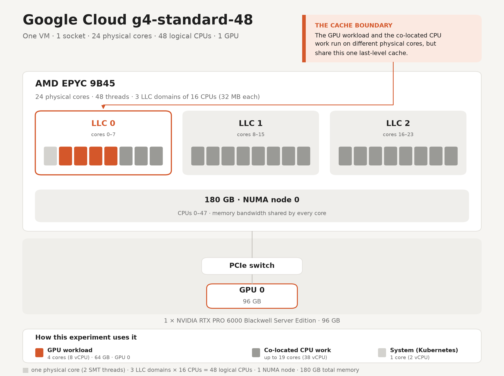
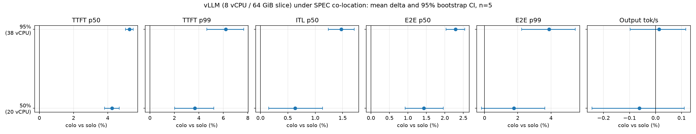
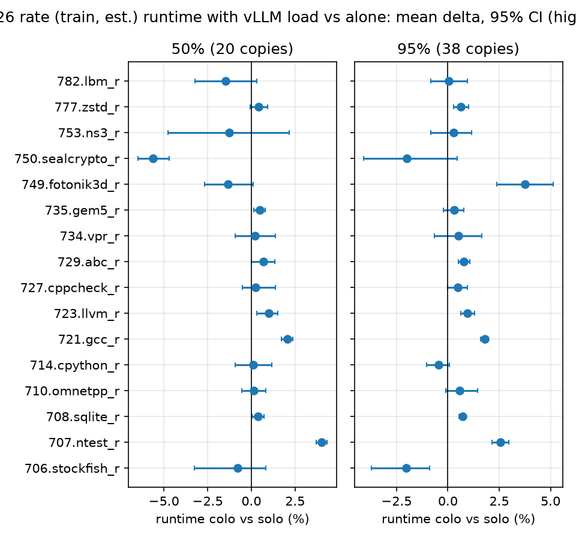
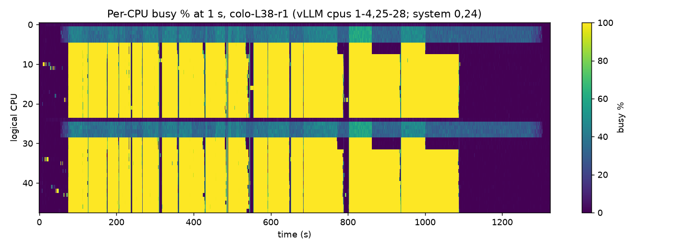
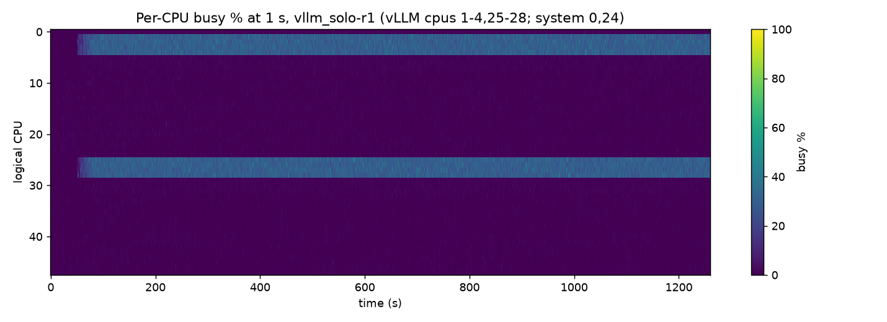

# g4-standard-48 co-location: GPU workload on an 8-vCPU slice, CPU work on the rest

**Question.** A `g4-standard-48` comes with 48 vCPU and 180 GB of memory next to one RTX PRO 6000 GPU. If the GPU
workload is held to 8 vCPU / 64 GB, can the other 40 vCPU run real CPU work without hurting the GPU workload?

**Answer.** Yes. With 38 of the 40 spare vCPU (every core Kubernetes can allocate) running SPEC CPU 2026, the GPU
workload served the same load with **0 failed requests, no throughput loss, and latency within +7.7%** (95% CI upper
bound, worst metric TTFT p99). Node CPU utilisation went from **5.2% to 79.8%**. Most SPEC benchmarks ran within ±1%
of their solo runtime.

**Headline colo ratio: 95% of the spare vCPU (38 / 40).**

This branch extends the G4 benchmark in [g4-readme.md](g4-readme.md) using the same workload, and replicates the
method of [*The Idle Half of a GPU Pod*](https://medium.com/google-cloud/the-idle-half-of-a-gpu-pod-8ec3ffaddc4c) on
a `g4-standard-48` instead of a `g4-standard-384`.

---

## 1. Setup



| Item | Value |
|---|---|
| Machine | `g4-standard-48` on GKE (us-west8-a): AMD EPYC 9B45, 24 cores / 48 threads, 3 L3 domains, 180 GB, 1 × RTX PRO 6000 (96 GB) |
| Isolation | kubelet static CPU manager; every pod is Guaranteed QoS with integer CPUs, so each gets exclusive whole cores |
| GPU workload | vLLM v0.32.0 (`vllm/vllm-openai@sha256:befccf0e…`), `Qwen/Qwen3-1.7B-Base`, FP16, prefix caching, `--api-server-count=4`; pod limited to **8 vCPU / 64 GiB / 1 GPU** on CPUs `1-4,25-28` |
| CPU workload | SPEC CPU 2026 v1.0.1 rate, train size, the 16 benchmarks used in the article (GCC 14, `-O3 -march=x86-64-v3`) |
| Colo levels | **50%**: 20 copies on 20 vCPU (CPUs `5-14,29-38`) · **95%**: 38 copies on 38 vCPU (CPUs `5-23,29-47`) |
| System | core 0 (CPUs `0,24`) stays in Kubernetes' shared pool for kubelet and daemons, so 38 of 40 spare vCPU is the maximum |
| Load | same prompts as [g4-readme.md](g4-readme.md) (~600-token prompts, ~11 output tokens), streamed, sent at a fixed **625 requests/s** = 75% of the measured 832 RPS capacity |

## 2. Method

**Scenarios.** Five kinds of run, each repeated 5 times:

| Scenario | GPU workload | SPEC |
|---|---|---|
| GPU solo (baseline) | load on | off |
| Colo 50% | load on | 20 copies |
| Colo 95% | load on | 38 copies |
| SPEC solo 50% / 95% | idle | 20 / 38 copies |

The 25 runs were **interleaved in random order in 5 blocks**, so drift over the 9-hour session spreads evenly instead of
favouring one scenario. Placement was identical in every run and recorded from the kubelet's CPU-manager state.

**Fixed-rate load.** Requests go out on a fixed schedule, whatever the server's response time. If co-location slows
the server, requests queue and latency rises visibly; the load does not back off to hide it.

**What is measured.** For each run, over a 10-minute window that starts 60 s into the load and always lies inside the
SPEC run: TTFT, inter-token latency (ITL), end-to-end latency (p50 and p99), output tokens/s, and failed requests,
measured at the client. Also per-CPU utilisation and steal, memory, and GPU utilisation/power/clocks at 1 s, plus
SPEC's per-benchmark runtime.

**Statistics.** Each run is one sample. The change vs solo is the ratio of means across the 5 reps, with a 95%
percentile-bootstrap CI.

**Pass bar.** This was fixed after the first solo and colo reps and before the other 23 runs
(commit `49d0e8a`, 2026-10-27 21:08 UTC). A level passes if every latency metric's 95% CI upper bound is ≤ +10%, output tokens/s has a CI
lower bound of ≥ −2%, and every colo run has 0 failed requests. The strict article-style test ("CI includes 0") is
reported too.

**Validity checks per run.** 0 failed requests; client schedule lag p99 < 50 ms (actual ≈ 2 ms, so the client was never
the bottleneck); all 16 SPEC benchmarks completed successfully; SPEC finished before the load stopped. All 25 runs
passed; none were discarded.

## 3. Results



### GPU workload: co-located vs solo

| Metric | Solo | Colo 50% | Colo 95% |
|---|---|---|---|
| TTFT p50 | 35.7 ms | 37.3 ms (+4.2% [+3.8, +4.7]) | 37.6 ms (+5.3% [+5.0, +5.5]) |
| TTFT p99 | 55.4 ms | 57.4 ms (+3.7% [+2.0, +5.2]) | 58.8 ms (+6.2% [+4.6, +7.7]) |
| ITL p50 | 11.8 ms | 11.9 ms (+0.6% [+0.2, +1.1]) | 12.0 ms (+1.5% [+1.2, +1.7]) |
| E2E latency p50 | 154.5 ms | 156.7 ms (+1.4% [+0.9, +2.0]) | 158.0 ms (+2.3% [+2.0, +2.5]) |
| E2E latency p99 | 220.2 ms | 224.0 ms (+1.8% [-0.2, +3.6]) | 228.7 ms (+3.9% [+2.2, +5.5]) |
| Output tokens/s | 6,914 | 6,910 (-0.1% [-0.2, +0.1]) | 6,915 (+0.0% [-0.1, +0.1]) |

Mean of 5 solo / 5 colo reps; brackets = 95% bootstrap CI of the change vs solo. Failed requests: solo 0, colo 0.

### Verdict per colo level

| Colo level | Spare vCPU used | Pass (≤ +10% latency, ≥ −2% throughput, 0 failures) | Strict (CI includes 0) |
|---|---|---|---|
| 50% | 20 of 40 | ✅ PASS | no |
| 95% | 38 of 40 | ✅ PASS | no |

**Headline colo ratio: 38/40 = 95% of the spare vCPU.**

### CPU workload: SPEC CPU 2026 rate runtime, co-located vs solo

| Benchmark | 50%: solo s → colo s (Δ, 95% CI) | 95%: solo s → colo s (Δ, 95% CI) |
|---|---|---|
| 706.stockfish_r | 50.0 → 49.7 (-0.77% [-3.25, +0.80]) | 52.4 → 51.3 (-2.04% [-3.72, -0.87]) |
| 707.ntest_r | 46.6 → 48.5 (+4.03% [+3.71, +4.33]) | 48.0 → 49.2 (+2.56% [+2.16, +2.97]) |
| 708.sqlite_r | 28.0 → 28.1 (+0.38% [+0.03, +0.73]) | 28.8 → 29.0 (+0.71% [+0.54, +0.86]) |
| 710.omnetpp_r | 25.1 → 25.1 (+0.15% [-0.53, +0.83]) | 25.9 → 26.0 (+0.57% [-0.10, +1.44]) |
| 714.cpython_r | 25.8 → 25.8 (+0.10% [-0.93, +1.18]) | 26.2 → 26.1 (-0.44% [-1.03, +0.09]) |
| 721.gcc_r | 39.0 → 39.8 (+2.05% [+1.73, +2.37]) | 40.3 → 41.0 (+1.79% [+1.60, +1.98]) |
| 723.llvm_r | 40.0 → 40.4 (+0.98% [+0.32, +1.50]) | 41.2 → 41.6 (+0.94% [+0.62, +1.29]) |
| 727.cppcheck_r | 64.9 → 65.1 (+0.26% [-0.53, +1.38]) | 67.3 → 67.6 (+0.48% [-0.00, +0.96]) |
| 729.abc_r | 51.6 → 51.9 (+0.69% [+0.02, +1.33]) | 53.6 → 54.0 (+0.79% [+0.52, +1.08]) |
| 734.vpr_r | 50.6 → 50.7 (+0.22% [-0.94, +1.35]) | 54.3 → 54.5 (+0.52% [-0.63, +1.65]) |
| 735.gem5_r | 36.5 → 36.7 (+0.49% [+0.15, +0.79]) | 37.3 → 37.5 (+0.31% [-0.22, +0.76]) |
| 749.fotonik3d_r | 111.7 → 110.2 (-1.33% [-2.66, +0.12]) | 128.1 → 132.9 (+3.76% [+2.40, +5.12]) |
| 750.sealcrypto_r | 57.0 → 53.8 (-5.62% [-6.49, -4.69]) | 57.1 → 56.0 (-2.01% [-4.12, +0.45]) |
| 753.ns3_r | 32.1 → 31.7 (-1.27% [-4.73, +2.16]) | 32.0 → 32.1 (+0.28% [-0.84, +1.17]) |
| 777.zstd_r | 97.5 → 97.9 (+0.42% [-0.05, +0.93]) | 103.2 → 103.9 (+0.62% [+0.27, +1.00]) |
| 782.lbm_r | 129.8 → 127.9 (-1.49% [-3.28, +0.34]) | 150.1 → 150.2 (+0.06% [-0.84, +0.94]) |

Estimated SPEC CPU 2026 results (train size, not SPEC-reviewed). Positive Δ = slower when co-located.

### What the node looks like

| Scenario | Node CPU busy (48 vCPU) | Memory used | GPU util | Max CPU steal |
|---|---|---|---|---|
| solo | 5.2% | 10.9 GiB | 98% | 0.00% |
| 50% | 45.5% | 14.6 GiB | 98% | 0.00% |
| 95% | 79.8% | 18.3 GiB | 98% | 0.00% |






*Per-CPU utilisation in a 95% colo run. Rows 1-4 and 25-28 are vLLM; the solid yellow blocks are SPEC benchmarks. Gaps
between blocks are SPEC setting up the next benchmark, which is why average node CPU is about 80% rather than 95%.*



*The same node with only the GPU workload running: 38 vCPU idle.*

### Reading the results

1. **The GPU workload loses nothing that matters.** Throughput is identical and nothing fails. TTFT p50 rises by about
   2 ms (35.7 → 37.6 ms) and end-to-end p50 by about 3.5 ms (154.5 → 158.0 ms).
2. **The cost comes from sharing cache and memory bandwidth, not CPU time.** vLLM's cores are exclusive, but its L3
   domain (cores 0-7) also holds SPEC cores 5-7 at both levels, and memory bandwidth is shared by every core. The
   article found the same mechanism.
3. **SPEC barely notices the GPU workload.** Most benchmarks are within ±1%. The memory-bandwidth-bound
   `749.fotonik3d_r` is +3.8% slower at 95%, matching the article. `750.sealcrypto_r` and `706.stockfish_r` ran
   slightly *faster* when co-located. This was measured, but its cause was not established.
4. **CPU steal was 0.00% in every run.**

## 4. Pricing input

| | Value | Source |
|---|---|---|
| `g4-standard-48`, 3-year CUD | $1.98/hr | GCP pricing, us-central1 |
| Spare 40 vCPU / 116 GB priced as 9 × `n4d-standard-2` + 11 × `n4d-highcpu-2`, 3-year CUD | $0.697/hr | GCP pricing, us-central1 |
| **Measured colo ratio** | **0.95** | this experiment |
| Effective GPU-node cost after crediting the reclaimed CPU: 1.98 − 0.95 × 0.697 | **$1.32/hr** | |

## 5. Why vLLM runs 4 API server processes

The first pilots used vLLM's default single API server process. That process alone handles HTTP, tokenisation and
streaming for every request, and ran about 60% busy at the target load. At 90% and 95% colo, SPEC's pressure on the
shared L3 cache pushed it to 100%, the queue grew without bound, and latency collapsed (TTFT reached 130 s+ with tens of
thousands of failed requests). A solo control of the same length stayed flat, so SPEC was the trigger.

`--api-server-count=4` spreads that work over 4 processes inside the same 8 vCPU. It also raised capacity from 726 to
832 RPS. With it, the busiest vLLM CPU stays around 40-55% under 95% colo and the collapse does not occur. The
single-frontend runs are kept in `g4_colo/results/archive_single_frontend/` and are not used in any result above.

## 6. Limitations

1. One model, one load point (75% of capacity), one machine shape, steady state. Bursts and autoscaling were not
   tested; keep burst headroom outside the reclaimed capacity.
2. SPEC at train size uses little memory (about 18 GiB at 95%), so this exercises co-located **CPU**, not filling the
   spare memory. Memory capacity is hard-limited per pod by cgroups; bandwidth, the shared part, is exercised.
3. SPEC CPU 2026 results are estimates (train size, not SPEC-reviewed).
4. Server-side vLLM metrics are partial with `--api-server-count > 1` (vLLM disables its stats logger), so latency is
   measured at the client.
5. Co-location shares microarchitecture (L3, branch predictors). Co-locate only code you trust on both sides.

## 7. Acceptance criteria

| # | Criterion | Result |
|---|---|---|
| AC1 | Disjoint, whole-core, identical placement in every run; steal logged | ✅ cpusets recorded per run; steal 0.00% |
| AC2 | Cost of limiting vLLM to 8 vCPU reported | ✅ appendix A (single-frontend config: 726 vs 738 RPS at 8 vs 40 vCPU) |
| AC3 | Every run valid, discards listed | ✅ 25 / 25 valid, 0 discarded |
| AC4 | vLLM impact per level, mean + 95% CI, n = 5 | ✅ section 3 |
| AC5 | SPEC impact per benchmark per level | ✅ section 3 |
| AC6 | Headline ratio + cost formula | ✅ 0.95; section 4 |
| AC7 | 1 s CPU / memory / GPU telemetry | ✅ `telemetry.csv` per run, heatmaps |
| AC8 | Reproducible from committed code and data | ✅ section 8 |
| AC9 | Peer review | see `g4_colo/PEER_REVIEW.md` |

## 8. Reproduce

```bash
cd g4_colo
# infra: node pool with infra/kubelet-config.yaml, namespace colo, k8s/telemetry.yaml, k8s/client.yaml,
#        k8s/spec-build.yaml (builds SPEC from the ISO), k8s/vllm-fp16-asc4.yaml
python3 orchestrate.py matrix --reps 5          # 25 interleaved runs, ~9 h
python3 analyze.py && python3 plots.py && python3 report.py
python3 diagrams/g4_layers.py
```

| Path | Contents |
|---|---|
| `experiment.json` | every parameter: rate, levels, windows, pass bar, capacity probe |
| `results/cells/<run>/` | per run: client summaries, per-second request aggregates, telemetry, cpusets, SPEC result files, logs |
| `results/analysis/` | `cells.csv`, `vllm_impact.csv`, `spec_impact.csv`, `level_pass.csv`, `validity_vllm.csv` |
| `results/plots/` | all figures |

Per-request client logs (about 600 MB) are not in git. They are kept outside the repo and can be provided on request.

## Appendix A: cost of the 8-vCPU limit (single-frontend config)

Same image and node, vLLM with one API server, closed-loop at 250 concurrent requests: 8 vCPU / 64 GiB reached 726
RPS (two runs: 728.1, 723.8) vs 738 RPS with 40 vCPU / 150 GiB (739.3, 737.5), i.e. −1.7%. Not repeated for the
4-process configuration.
