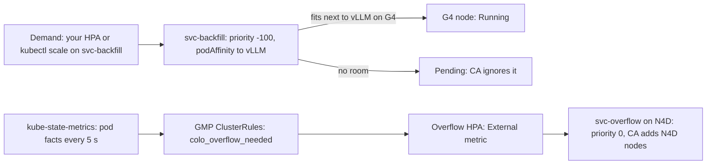

# G4 Co-Location at Scale on GKE: Native Recipe (no custom controller)

Same goal as [`../recipe/`](../recipe/README.md): run CPU services on the idle cores of G4 GPU nodes, spill the rest to N4D CPU nodes, never buy a GPU node for CPU work, and keep vLLM's TTFT p99 within 1.5× of solo. The difference: **no `colo-controller`**. Every decision is made by stock GKE components reading YAML and PromQL.

`scripts/check_no_custom_code.py` enforces this. It renders every overlay and fails if any image of ours other than the workload (or demo traffic and telemetry in `overlays/demo`) runs, or if any of our service accounts can write Deployments, scale subresources, Pods, Nodes, HPAs or rules. It fails on `../recipe/` with 11 findings.

## 1. How it works



| Job | recipe/ (custom controller) | recipe-native (stock only) |
|---|---|---|
| Which G4 nodes take CPU work | Controller labels `colo.active=true` | Required **podAffinity** to `app=vllm` on the same node |
| Never buy a G4 node for CPU work | Priority -100 | Same, plus CA's own simulation: a new G4 node has no vLLM pod, so podAffinity fails there |
| Split demand into G4 and N4D | Controller computes slots and patches both Deployments | `<svc>-backfill` holds the **whole demand**. Pods beyond the free slots wait in `Pending`. An **HPA** on `colo_overflow_needed` (a GMP recording rule in [`base/rules.yaml`](base/rules.yaml)) runs that many on N4D |
| Move work back onto a new G4 node | Controller shifts replicas | Pending backfill pods bind as soon as vLLM lands there. The overflow HPA shrinks after 60 s |
| Make-before-break on G4 scale-in | Controller waits for N4D, then deletes | The rule stops counting backfill on a node whose vLLM left, so N4D scales up at once. The `g4-gpu` ComputeClass keeps the node, and its backfill serving, for `consolidationDelayMinutes: 3` |
| TTFT guard (memory-heavy) | Per-node eviction on p99 breach | The admission policy keeps `colo.class=memory-heavy` off G4 entirely. `analytics` runs only on N4D |
| Shared-core reserve | `reserve_cpu_per_node: 2` | [`base/g4-reserve.yaml`](base/g4-reserve.yaml): a Burstable 2-CPU pause DaemonSet on G4 |
| Warm N4D buffer | Controller scales `colo-buffer` | Fixed `replicas: 1` |

The recording rules ([`base/rules.yaml`](base/rules.yaml), generated by [`base/gen_colo_services.py`](base/gen_colo_services.py)), evaluated every 10 s:
- `colo_backfill_desired{service}`: backfill pods that exist (the demand).
- `colo_backfill_effective{service}`: backfill pods Ready on a node that runs a Ready vLLM pod.
- `colo_overflow_needed{service}` = desired − effective.

Managed Prometheus has no staleness markers, so every pod series is filtered to "scraped in the last 20 s" with `timestamp()`.

## 2. Measured on `g4cluster-jawadamin-us-west8-1126` (same shapes, model, and GKE 1.35.8 as recipe/)

Raw data: `.agents/native/logs/` (`N0_lag.json`, `gate_native.run{1,2,3}.verdict.json`, `gate_native.samples.jsonl`).

| Check | recipe/ (wave 2) | recipe-native | Threshold |
|---|---|---|---|
| Metric lag, demand change → overflow HPA acts (scale-up, 2 rounds) | 2 s loop | metric 11–14 s, HPA 17–27 s | ≤ 60 s |
| Overflow pods Ready after a demand change | seconds after the scale patch | 30 s warm N4D, 101 s with a new N4D node | — |
| Overflow scale-down after backfill frees up | at once | 70–80 s (60 s stabilization on purpose) | — |
| TTFT p99, solo → with backfill, 450 rps | 20 → 22 ms (1.10×, 18 pods) | 20 → 26 ms (1.30×, 18 pods + 2-core reserve, `run3`); 20 → 28 ms (1.40×) with 19 pods and no reserve (`run2`) | ≤ 1.5× |
| G4 scale-ups caused by CPU demand | 0 | 0 (61 pods Pending for 15 min; and 20/20 for 10 min) | 0 |
| Steady state at demand 20/20 | — | covered 111 s after the change, then 0 deviation | ≤ 2 pods |
| GPU scale-out: new G4 node's slots filled after 2nd vLLM Ready | 94 % at +4 s | 100 % (17/17) at 0 s | ≥ 90 % ≤ 60 s |
| GPU scale-in 2 → 1: Ready ≥ demand | 100 % of 150 samples | 100 % of 246 samples (min 18/18) | ≥ 99 % |

The TTFT gap (1.30× here vs 1.10× in recipe/) was measured on two different clusters on different days, so it may be partly host variance. An A/B run on one cluster has not been done yet.

## 3. Trade-offs you accept

1. **Slower reaction.** The overflow tier follows demand in about 20–30 s, not 2 s, because the metric goes through Managed Prometheus, the rule evaluator, the metrics adapter and the HPA.
2. **One overflow pod per service always runs.** HPA can't scale to 0 on GKE (`HPAScaleToZero` is alpha).
3. **No dynamic TTFT guard.** Memory-heavy services never use G4, so you give up their savings in exchange for no eviction logic.
4. **Pending pods are normal.** `kubectl get pods` shows Pending backfill whenever demand exceeds the free G4 slots. The ResourceQuota counts them, so it is sized at about 2× peak demand.
5. **Make-before-break is time-based.** It costs up to 3 extra G4-minutes per scale-in (`consolidationDelayMinutes: 3`).
6. **Two more stock components:** upstream kube-state-metrics (pods only, 5 s scrape) and one GMP `ClusterRules` object.

## 4. Deploy

```bash
# 1. Cluster (GKE Standard, Managed Prometheus on), then pools + IAM:
PROJECT=... CLUSTER=... REGION=... SUFFIX=... G4_ZONES=... N4D_ZONES=... \
  bash g4_colo/recipe-native/infra/create-node-pools.sh
# 2. Edit overlays/production-template/settings.yaml (clusterName, pools, model, gateway) and images:, then
kubectl apply -k g4_colo/recipe-native/overlays/production-template
# 3. Point your usual autoscaler at <svc>-backfill (example: overlays/production-template/demand-hpa.yaml).
# 4. Checks
python3 g4_colo/recipe-native/scripts/check_no_custom_code.py
python3 g4_colo/recipe-native/scripts/check_sync.py     # shared manifests identical to recipe/
```

Shared with `recipe/` and kept identical by `check_sync.py`: `base/vllm.yaml`, `base/loadgen.yaml`, `base/custom-metrics-adapter.yaml`, `infra/kubelet-config.yaml`. Images: `colo-worker` only (demo also uses `colo-loadgen` and `colo-node-agent`).

## 5. Files

| Path | What |
|---|---|
| `base/cluster.yaml` | Namespaces, PriorityClasses, ComputeClasses (`g4-gpu` with `consolidationDelayMinutes: 3`) |
| `base/gen_colo_services.py` → `colo-services.yaml`, `rules.yaml` | Backfill and overflow Deployments, overflow HPAs, buffer, recording rules |
| `base/ksm.yaml` | Upstream kube-state-metrics limited to pods in `colo-svc` and `inference` |
| `base/guardrails.yaml` | `colo-g4-guard` VAP (+ memory-heavy ban, reserve exemption), quota, NetworkPolicies |
| `base/g4-reserve.yaml` | 2 shared cores held per G4 node |
| `base/node-agent.yaml` | Demo telemetry only (read-only) |
| `overlays/demo`, `overlays/production-template` | Environment settings |
| `tests/lag_probe.py`, `tests/gate_native.py` | Live measurements behind section 2 |
