# G4 Co-Location at Scale on GKE: Native Recipe (no custom controller)

Same goal as [`../recipe/`](../recipe/README.md): run CPU services on the idle cores of G4 GPU nodes, spill the rest to N4D CPU nodes, never buy a GPU node for CPU work, and keep vLLM's TTFT p99 within 1.5× of solo. The difference: **no `colo-controller`**. Every decision is made by stock GKE components reading YAML and PromQL.

`scripts/check_no_custom_code.py` enforces this. It renders every overlay and fails if any image of ours other than the workload (or demo traffic and telemetry in `overlays/demo`) runs, or if any of our service accounts can write Deployments, scale subresources, Pods, Nodes, HPAs or rules. It fails on `../recipe/` with 11 findings.

## 1. How it works

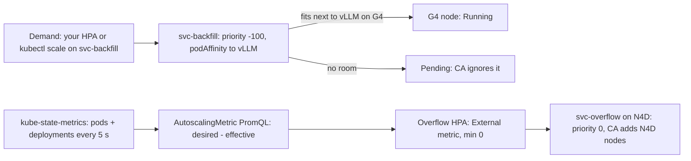

| Job | recipe/ (custom controller) | recipe-native (stock only) |
|---|---|---|
| Which G4 nodes take CPU work | Controller labels `colo.active=true` | Required **podAffinity** to `app=vllm` on the same node |
| Never buy a G4 node for CPU work | Priority -100 | Same, plus CA's own simulation: a new G4 node has no vLLM pod, so podAffinity fails there |
| Split demand into G4 and N4D | Controller computes slots and patches both Deployments | `<svc>-backfill` holds the **whole demand**. Pods beyond the free slots wait in `Pending`. An **HPA** (`minReplicas: 0`, `tolerance: 0`) reads a PromQL query through GKE's managed **AutoscalingMetric** (`overlays/*/autoscaling-metric.yaml`, generated per cluster) and runs that many on N4D |
| Move work back onto a new G4 node | Controller shifts replicas | Pending backfill pods bind as soon as vLLM lands there. The overflow HPA shrinks after 30 s, down to 0 |
| Make-before-break on G4 scale-in | Controller waits for N4D, then deletes | The rule stops counting backfill on a node whose vLLM left, so N4D scales up at once. The `g4-gpu` ComputeClass keeps the node, and its backfill serving, for `consolidationDelayMinutes: 3` |
| TTFT guard (memory-heavy) | Per-node eviction on p99 breach | The admission policy keeps `colo.class=memory-heavy` off G4 entirely. `analytics` runs only on N4D |
| Shared-core reserve | `reserve_cpu_per_node: 2` | [`base/g4-reserve.yaml`](base/g4-reserve.yaml): a Burstable 2-CPU pause DaemonSet on G4 |
| Warm N4D buffer | Controller scales `colo-buffer` | Fixed `replicas: 1` |

The split, generated by [`base/gen_colo_services.py`](base/gen_colo_services.py). The HPAs read it as per-service PromQL through AutoscalingMetric; the same expressions are also recorded every 5 s by [`base/rules.yaml`](base/rules.yaml) for dashboards and tests:
- `colo_backfill_desired{service}`: the backfill Deployment's `spec.replicas` (the demand). One series per Deployment, so pod churn can't double-count it.
- `colo_backfill_effective{service}`: backfill pods Ready on a node that runs a Ready vLLM pod that is not terminating.
- `colo_overflow_needed{service}` = desired − effective.

Managed Prometheus has no staleness markers, so every pod series is filtered to "scraped in the last 15 s" with `timestamp()`. If kube-state-metrics stops, the query returns nothing and the HPAs hold their size.

## 1b. Scenario flows

How the stock pieces combine in each scenario. Timings are measured on the demo cluster (section 2, `.agents/bench/`).

### The pieces

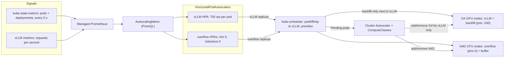

Three rules make it work without a controller:
1. **Backfill holds the whole demand.** Its pods may only bind next to a vLLM pod (podAffinity). The ones that don't fit stay `Pending` at priority -100, which the Cluster Autoscaler ignores.
2. **Overflow = backfill pods not Ready next to a Ready vLLM pod.** This is one PromQL query, read by the overflow HPA.
3. **Guardrails:** the admission policy keeps memory-heavy pods off G4. The reserve DaemonSet holds 2 shared cores per G4 node.

---

### 1. GPU scale-out (more LLM traffic)

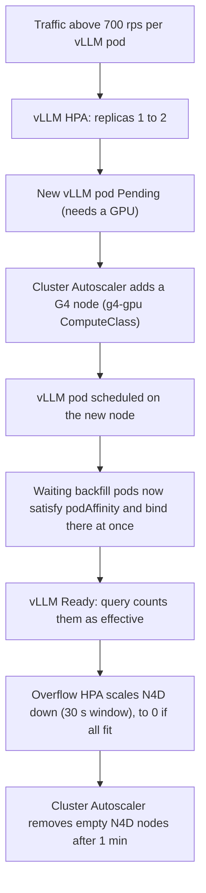

Measured: 2nd vLLM Ready in about 270 s; new G4 node 100 % filled the moment vLLM was Ready.

### 2. GPU scale-in (less LLM traffic)

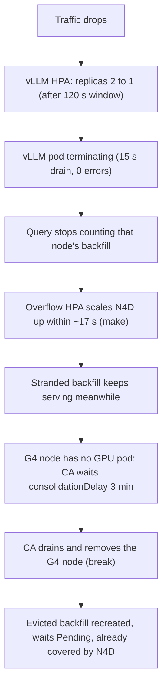

Measured: Ready pods ≥ demand in 100 % of samples; G4 node removed about 600 s after the traffic drop.

### 3. CPU scale-out (more CPU demand)

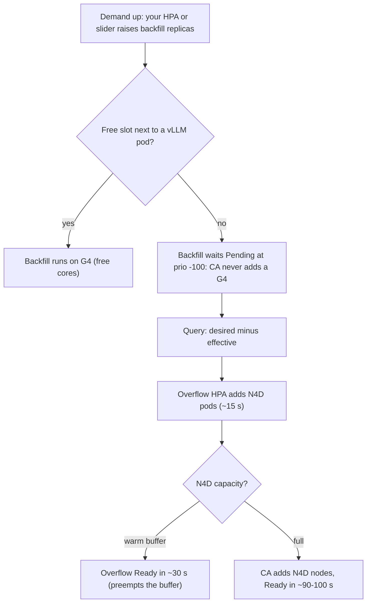

Measured: 18 to 40 pods fully covered in 88 s; 0 G4 nodes added for CPU demand.

### 4. CPU scale-in (less CPU demand)

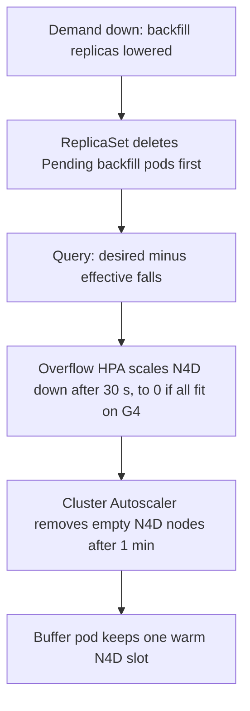

Measured: overflow fully drained 38 s after the demand drop.

## 2. Measured on `g4cluster-jawadamin-us-west8-1126` (same shapes and model as recipe/; GKE 1.35.8, then 1.37.1)

Raw data: `.agents/native/logs/` (`N0_lag.json`, `gate_native.run{1,2,3}.verdict.json`, `gate_native.samples.jsonl`).

| Check | recipe/ (wave 2) | recipe-native | Threshold |
|---|---|---|---|
| Demand change → overflow HPA acts (scale-up) | 2 s loop | 1.35 (rules + Stackdriver adapter): 17–27 s. **1.37 (AutoscalingMetric): 14–16 s** (`N0_lag_v2_gke137.json`) | ≤ 60 s |
| vLLM leaves a G4 node → overflow scaled up | controller loop | before the fix: ~50 s, with a down-then-up flap (run1). **After: 17 s** (live, 20:21:01 → 20:21:18) | — |
| Overflow pods Ready after a demand change | seconds after the scale patch | 30 s warm N4D, 101 s with a new N4D node | — |
| Overflow scale-down after backfill frees up | at once | 1.35: 70–80 s. **1.37: 32 s** (30 s stabilization), down to 0 pods | — |
| TTFT p99, solo → with backfill, 450 rps | 20 → 22 ms (1.10×, 18 pods, 30 Oct) | 20 → 26 ms (1.30×, 18 pods + 2-core reserve, `run3`); 20 → 28 ms (1.40×) with 19 pods and no reserve (`run2`) | ≤ 1.5× |
| TTFT p99, same moment on both clusters, 700 rps per vLLM pod | full node: 42–44 ms (19 pods; vLLM cores spread over 2 L3 domains) | full node: 34–36 ms (18 pods + reserve; vLLM in one L3 domain) | — |
| G4 scale-ups caused by CPU demand | 0 | 0 (61 pods Pending for 15 min; and 20/20 for 10 min) | 0 |
| Steady state at demand 20/20 | — | covered 111 s after the change, then 0 deviation | ≤ 2 pods |
| GPU scale-out: new G4 node's slots filled after 2nd vLLM Ready | 94 % at +4 s | 100 % (17/17) at 0 s | ≥ 90 % ≤ 60 s |
| GPU scale-in 2 → 1: Ready ≥ demand | 100 % of 150 samples | 100 % of 246 samples (min 18/18) | ≥ 99 % |

TTFT depends on the number of backfill pods on the node and on whether vLLM's cores sit in one L3 domain (G4: AMD EPYC 9B45, 3 × 16-vCPU L3 domains), not on the recipe. Measured at the same moment and load, the native full node was 8 ms faster than the controller's.

### Benchmark charts (2 Nov sweep, both clusters)

The same scenarios ran on both clusters ([`../bench_compare/sweep.py`](../bench_compare/sweep.py); charts from [`charts.py`](../bench_compare/charts.py)). Phases that scale N4D were rerun one cluster at a time, because both clusters share one regional N4D quota ([`docs/bench/SOURCES.md`](docs/bench/SOURCES.md)). All numbers: [`docs/bench/summary.md`](docs/bench/summary.md). Navy = controller recipe, green = native recipe.

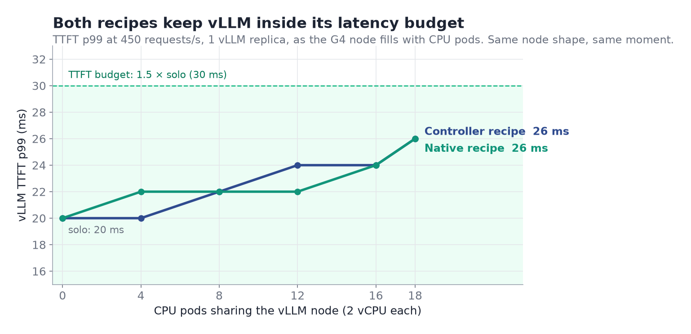

Filling the G4 node with 18 CPU pods raises vLLM TTFT p99 from 20 to 26 ms on both recipes, inside the 30 ms budget.

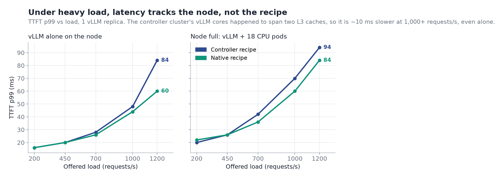

Above ~700 requests/s TTFT climbs steeply on both. The controller cluster is ~10 ms slower even with vLLM alone, because its vLLM cores span two L3 caches. That is a placement effect, not a recipe effect.

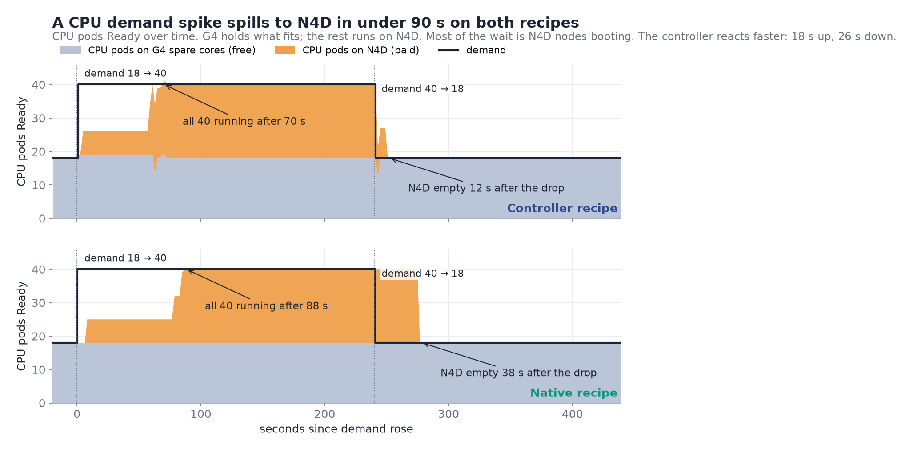

Grey is free capacity on G4; orange is paid N4D. The controller covers the spike 18 s sooner and empties N4D 26 s sooner. Both are dominated by N4D boot time.

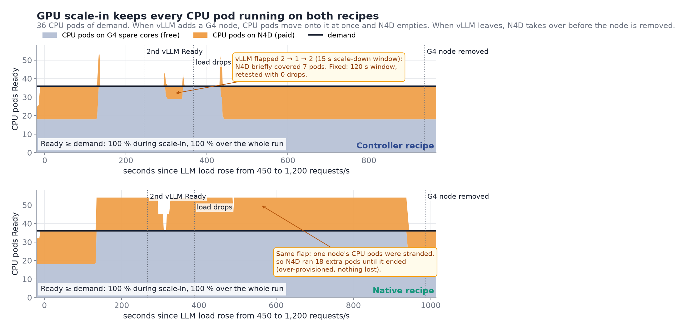

When vLLM scales out, CPU pods move onto the new G4 node and N4D empties. When it scales in, N4D takes over before the node goes. Ready ≥ demand held in 100 % of samples on both. The flap marked in amber is fixed (see below).

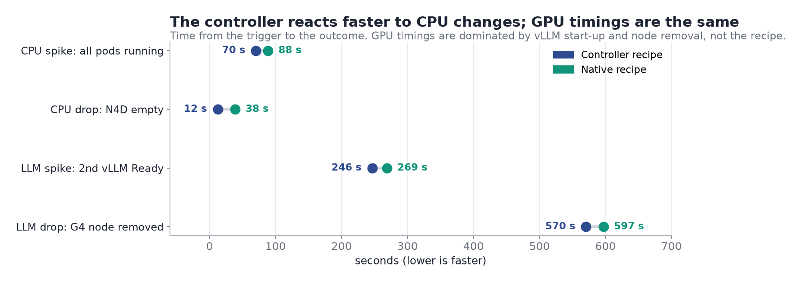

**Fixes from the sweep, retested live on 3 Nov** ([`../bench_compare/retest_fixes.py`](../bench_compare/retest_fixes.py), [`docs/bench/retest_verdict.json`](docs/bench/retest_verdict.json)):
- vLLM HPA scale-down window 15 s → 120 s (shared `vllm.yaml`). Before: the 2nd vLLM was removed within ~45 s of becoming Ready. After: 0 drops in 240 s at 1,200 rps.
- Controller (recipe/, v0.2.5+) keeps stranded backfill while overflow pods are not Ready. Before: toolcall fell to 8 of 18 when N4D could not start. After, with the N4D pool capped: Ready ≥ demand in 100 % of samples (min 18/18) until the autoscaler drained the node, 314 s after scale-in.

## 3. Trade-offs you accept

1. **Slower reaction.** The overflow tier follows demand in about 15 s, not 2 s: kube-state-metrics scrape (5 s, the Managed Prometheus minimum) + ingestion + the HPA's fixed 15 s sync.
2. **Needs GKE ≥ 1.37** for HPA scale to zero (`minReplicas: 0`) and ≥ 1.36.2 for AutoscalingMetric PromQL (Preview). On older GKE set `minReplicas: 1` (one pod per service stays on N4D) and read the recording rule through custom-metrics-stackdriver-adapter.
3. **No dynamic TTFT guard.** Memory-heavy services never use G4, so you give up their savings in exchange for no eviction logic.
4. **Pending pods are normal.** `kubectl get pods` shows Pending backfill whenever demand exceeds the free G4 slots. The ResourceQuota counts them, so it is sized at about 2× peak demand.
5. **Make-before-break is time-based.** It costs up to 3 extra G4-minutes per scale-in (`consolidationDelayMinutes: 3`).
6. **Stock components added:** upstream kube-state-metrics (pods and Deployments only, 5 s scrape), one GMP `ClusterRules` (observability), two `AutoscalingMetric` objects. No custom-metrics-stackdriver-adapter: it would own the external-metrics API and hide GKE's managed adapter.

## 3b. Customer DaemonSets on G4

Node agents you already run on your CPU nodes (log shippers, monitoring, security sensors) can also run on the G4 nodes that now carry CPU work. Three changes, shown in [`components/customer-daemonset/agent.yaml`](../recipe/components/customer-daemonset/agent.yaml):

1. **Label the agent's namespace** `colo.gke.io/g4-daemonsets: allowed`. Only cluster admins can label namespaces.
2. **Tolerate the two G4 taints:** `cloud.google.com/compute-class=g4-gpu:NoSchedule` and `nvidia.com/gpu:NoSchedule`.
3. **Include G4 in the node selection**, e.g. `colo.role In [g4, n4d]`.

`colo-g4-guard` admits a pod onto G4 through this path only when all three hold:
- the **DaemonSet controller** created it (`system:serviceaccount:kube-system:daemon-set-controller`; a pod's ownerReferences can be forged, this identity can't);
- its namespace has the label;
- it requests **no GPU**.

gVisor stays banned on G4. A person creating the same pod directly is denied. So is a G4-tolerating DaemonSet in an unlabelled namespace, on every node: a G4 toleration alone marks a pod as G4-bound, so it fails closed. DaemonSets without the G4 tolerations run on CPU nodes as before. All of this is tested by `../recipe/tests/admission_cases.py` and `../recipe/tests/daemonset_check.py`.

What changes on the node:
- **vLLM stays isolated.** A Burstable agent runs only on the node's shared cores; it is not in the kubelet CPU manager's exclusive allocations.
- **Backfill shrinks to fit.** Agent CPU requests come out of the backfill budget: every 2 vCPU requested is one fewer 2-vCPU backfill pod per G4 node. The scheduler fits fewer backfill pods; the rest wait and the overflow HPA covers them on N4D.
- **Rollouts always land.** At normal priority (0) a new agent pod preempts a priority -100 backfill pod on a full node; that pod is covered on N4D.
- **Watch the shared cores.** A heavy agent competes with kubelet and containerd on the shared cores. Raise the reserve (`base/g4-reserve.yaml`) if it uses more than a fraction of a core.

## 3c. TPU v6e as the accelerator host

The same recipe runs with Cloud TPU v6e in place of G4 (`overlays/tpu-v6e`, demo cluster `v6ecluster-jawadamin-us-east5-1126`). `ct6e-standard-1t` (1 chip, 44 vCPU, 176 GiB) is the closest TPU shape to `g4-standard-48` (48 vCPU, 180 GiB), so the backfill sizing carries over.

| | G4 (`overlays/demo`) | TPU v6e (`overlays/tpu-v6e`) |
|---|---|---|
| Accelerator pool | `g4-standard-48`, 1 × RTX PRO 6000 | `ct6e-standard-1t`, 1 × v6e, single-host (topology 1x1) (`ACCELERATOR=tpu-v6e`, optional `SPOT=1`) |
| vLLM | `vllm/vllm-openai`, `nvidia.com/gpu: 1` | `vllm/vllm-tpu`, `google.com/tpu: 1`, TPU node selectors (GKE requires both) |
| Extra toleration | — | `google.com/tpu` on backfill, the reserve, the node agent and customer DaemonSets |
| vLLM HPA target | 700 completed req/s per pod | 250 (one v6e replica saturates near 330 req/s) |
| vLLM liveness | — | `engine_progress_check.py`: restart when requests are in flight and no token is generated for ~2 min (the engine can hang while `/health` stays 200) |
| TPU interrupts | — | `irq-pin.yaml`: DaemonSet pins the TPU's vfio MSI-X IRQs to the shared cores (0, 22), so they never land on a backfill pod's exclusive core (the cause of engine stalls at full backfill) |
| Everything else | ComputeClasses, backfill affinity, overflow HPAs, rules, VAP | identical |

Zone check: `gcloud compute machine-types list` shows `ct6e-*` in `us-west8-a`, but GKE rejects v6e node pools there (`CONDITION_NOT_MET: Unsupported TPU configuration`, on-demand and Spot, 1t and 4t). The demo cluster therefore runs in `us-east5` (zones a/b), with its own N4D quota.

The accelerator pool keeps the recipe's class identifiers (`compute-class=g4-gpu`, `colo.role=g4`), so only vLLM and one toleration differ. The admission policy treats `google.com/tpu` exactly like `nvidia.com/gpu`: only the serving workload in `inference` may request it, and a `gke-tpu-accelerator` selector or affinity counts as targeting the accelerator host.

```bash
PROJECT=... CLUSTER=... REGION=... SUFFIX=... G4_ZONES=<zones with v6e> N4D_ZONES=... ACCELERATOR=tpu-v6e \
  bash g4_colo/recipe-native/infra/create-node-pools.sh
python3 g4_colo/recipe-native/base/gen_colo_services.py --cluster <your-cluster> --out g4_colo/recipe-native/overlays/tpu-v6e
kubectl apply -k g4_colo/recipe-native/overlays/tpu-v6e
# Demo UI only: the read/scale RBAC for the Cloud Run demo identity (ServiceAccount, Roles, Bindings from demo/k8s.yaml,
# not its in-cluster Deployment). Without it the demo shows "list nodes: Forbidden" for this cluster.
```

## 4. Deploy

```bash
# 1. Cluster (GKE Standard, Managed Prometheus on), then pools + IAM:
PROJECT=... CLUSTER=... REGION=... SUFFIX=... G4_ZONES=... N4D_ZONES=... \
  bash g4_colo/recipe-native/infra/create-node-pools.sh
# 2. Edit overlays/production-template/settings.yaml (pools, model, gateway) and images:, generate the metric source:
python3 g4_colo/recipe-native/base/gen_colo_services.py --cluster <your-cluster> --out g4_colo/recipe-native/overlays/production-template
#    then
kubectl apply -k g4_colo/recipe-native/overlays/production-template
# 3. Point your usual autoscaler at <svc>-backfill (example: overlays/production-template/demand-hpa.yaml).
# 4. Checks
python3 g4_colo/recipe-native/scripts/check_no_custom_code.py
python3 g4_colo/recipe-native/scripts/check_sync.py     # shared manifests identical to recipe/
```

Shared with `recipe/` and kept identical by `check_sync.py`: `base/vllm.yaml`, `base/loadgen.yaml`, `infra/kubelet-config.yaml` (the vLLM HPA's metric is patched in `base/kustomization.yaml`). Images: `colo-worker` only (demo also uses `colo-loadgen` and `colo-node-agent`).

## 5. Files

| Path | What |
|---|---|
| `base/cluster.yaml` | Namespaces, PriorityClasses, ComputeClasses (`g4-gpu` with `consolidationDelayMinutes: 3`) |
| `base/gen_colo_services.py` → `colo-services.yaml`, `rules.yaml`, `overlays/*/autoscaling-metric.yaml` | Backfill and overflow Deployments, overflow HPAs, buffer, recording rules, per-cluster AutoscalingMetric |
| `base/ksm.yaml` | Upstream kube-state-metrics limited to pods in `colo-svc` and `inference` |
| `base/guardrails.yaml` | `colo-g4-guard` VAP (+ memory-heavy ban, reserve exemption), quota, NetworkPolicies |
| `base/g4-reserve.yaml` | 2 shared cores held per G4 node |
| `base/node-agent.yaml` | Demo telemetry only (read-only) |
| `overlays/demo`, `overlays/production-template` | Environment settings |
| `overlays/tpu-v6e` | TPU v6e accelerator host: vLLM TPU patch + `google.com/tpu` toleration (section 3c) |
| `tests/lag_probe.py`, `tests/gate_native.py` | Live measurements behind section 2 |
