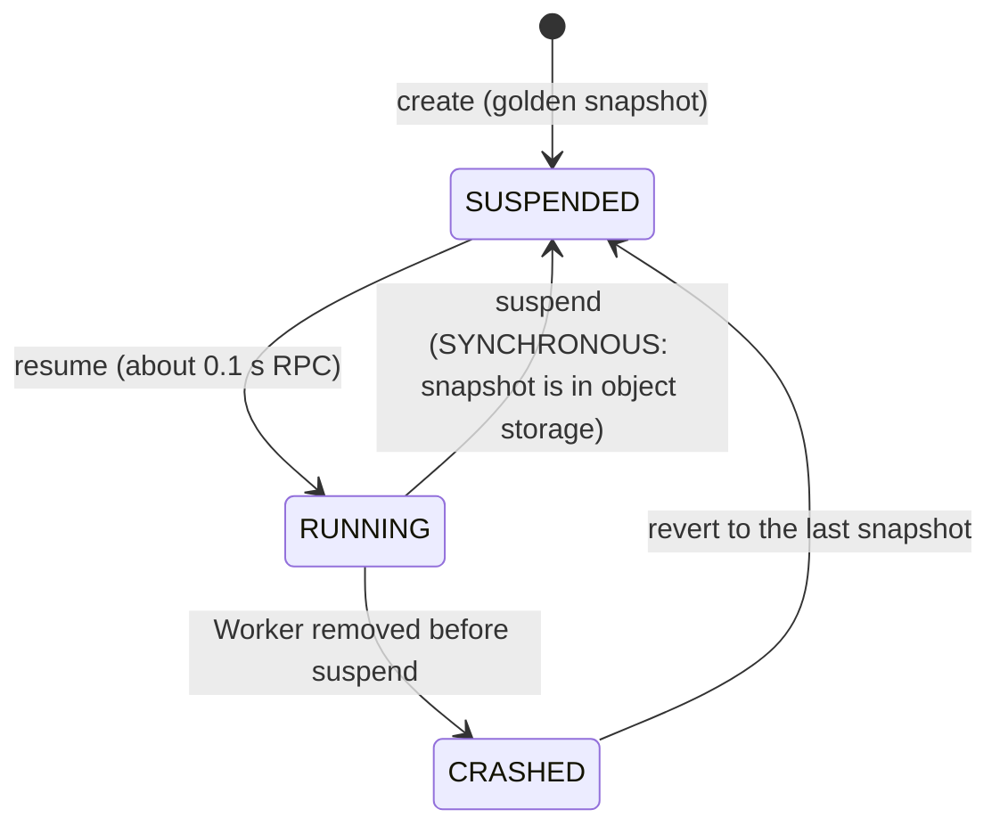
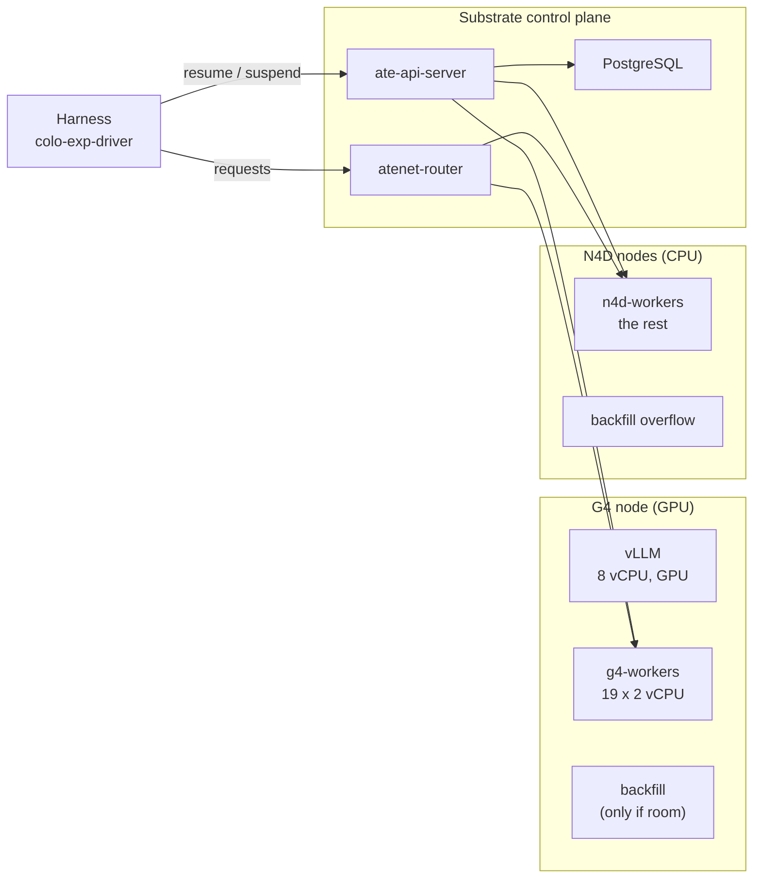
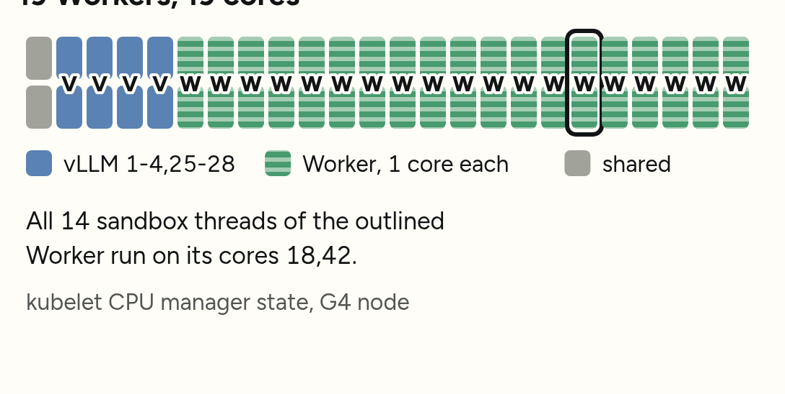
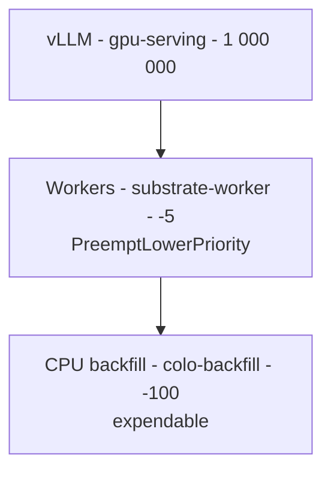
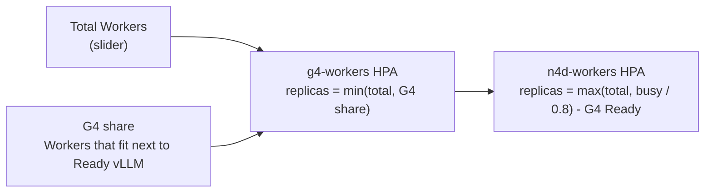
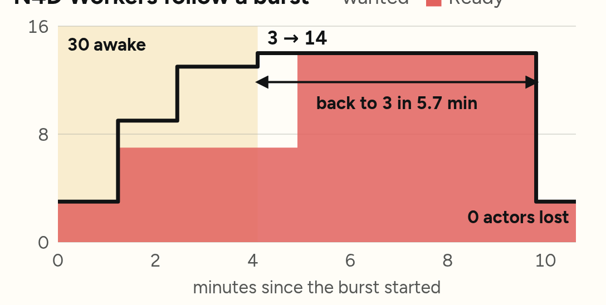
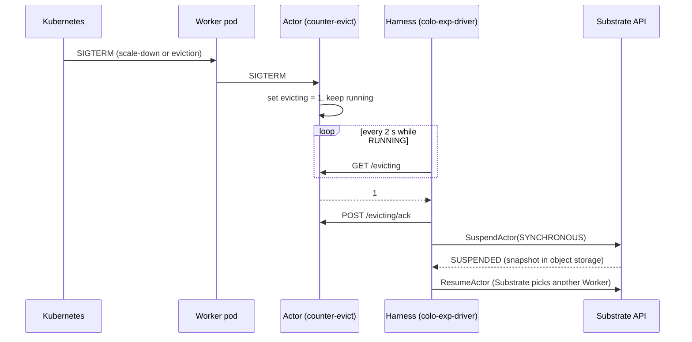
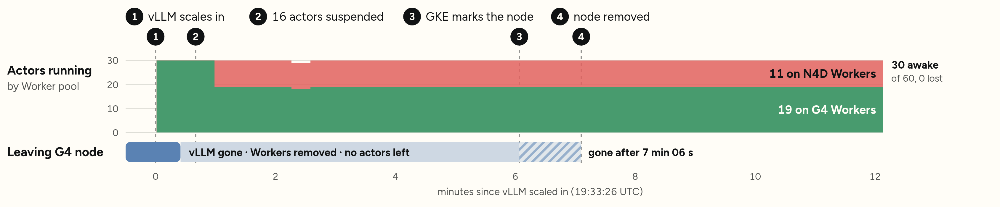
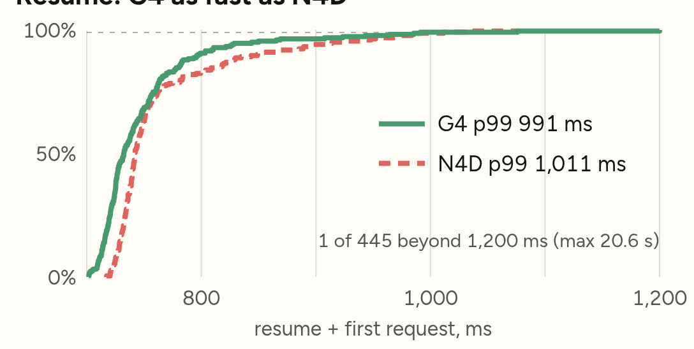

# Agent Substrate on the spare CPU of G4 GPU nodes

This directory contains the setup and the test tools for one design. The design runs
[Agent Substrate](https://cloud.google.com/blog/products/containers-kubernetes/agent-substrate-available-on-gke)
Workers on the CPU cores that vLLM does not use on G4 GPU nodes. When the G4 nodes are full, the Workers run on N4D
CPU nodes.

The text uses Simplified Technical English (ASD-STE100) style: short sentences, active voice, one instruction in
each step.

> [!IMPORTANT]
> Do not change `g4_colo/recipe/` or `g4_colo/recipe-native/`. This design adds objects to a cluster that runs the
> native recipe. It does not edit the recipe.

## Contents

1. [The problem](#1-the-problem)
2. [Key concepts](#2-key-concepts)
3. [How the design works](#3-how-the-design-works)
4. [Results](#4-results)
5. [Install and operate](#5-install-and-operate)
6. [Files](#6-files)
7. [Limits and known problems](#7-limits-and-known-problems)

## 1. The problem

A G4 node (`g4-standard-48`) has 48 vCPUs and one GPU. vLLM uses the GPU and only 8 vCPUs. The other vCPUs are idle.

AI agents need CPU. Each agent runs in a sandbox. Most agents are idle most of the time. Agent Substrate keeps idle
agents as snapshots in object storage. It starts an agent again in less than one second when the agent gets work.

The goal: use the idle G4 cores for agents. Do not slow down vLLM. Do not lose an agent when GKE removes a G4 node.

## 2. Key concepts

| Term | Meaning |
|---|---|
| **Actor** | One agent. It runs in a gVisor sandbox. It is RUNNING or SUSPENDED. |
| **Suspend** | Substrate takes a snapshot of the actor (memory, files) and stops it. The actor then uses no CPU. |
| **Resume** | Substrate starts the actor again from its snapshot, on any Worker that has room. |
| **Worker** | A pod that hosts actors. Here, one Worker has 2 vCPUs and 4 GiB and hosts one active actor. |
| **WorkerPool** | A set of Workers. This design uses two: `g4-workers` (on G4) and `n4d-workers` (on N4D). |
| **Harness** | The program that drives the actors. In this directory it is `colo-exp-driver`. |
| **Backfill** | The CPU services of the recipe (`sandbox`, `toolcall`) that also use spare G4 cores. |
| **Spare cores** | G4 cores that vLLM, system pods and DaemonSets do not request. |

## 3. How the design works

### 3.1 Overview

The control plane runs on two small dedicated nodes: one `n4d-standard-4` and one `e2-standard-4` (PostgreSQL).

### 3.2 Placement: Workers go next to vLLM

A Worker pod must run on a G4 node that has a Ready vLLM pod. The WorkerPool API has no `podAffinity` field. A
**MutatingAdmissionPolicy** adds the `podAffinity` term to each `g4-workers` pod at admission
(`manifests-native/worker-affinity-map.yaml`). This is a standard Kubernetes object. There is no custom controller.

The recipe's admission policy `colo-g4-guard` controls which pods can run on G4. It admits pods with whole CPUs only,
so each pod gets its own cores. The script `install/allow-substrate-worker.sh` adds the priority class
`substrate-worker` to its allow list. Run the script again after each recipe apply.

Result: each Worker uses only its own cores. The probe found all 14 sandbox threads of one Worker on cores 18 and 42.
vLLM keeps cores 1–4 and 25–28.

### 3.3 Priority: Workers before backfill

- vLLM can take cores from Workers.
- Workers can take cores from backfill, on G4 and on N4D.
- The priority of Workers (−5) is above the Cluster Autoscaler cutoff (−10). Thus the autoscaler **evicts** a Worker
  with its grace period. It does not delete the node under the Worker. Section 3.5 tells why this is important.

### 3.4 Sizing: one number, two pools

The user sets one number: **Total Workers** (the UI slider). The number is `maxReplicas` of the HPA `g4-workers`.

| Value | Formula | Source |
|---|---|---|
| G4 share | Sum, over G4 nodes with a Ready vLLM pod, of floor((allocatable CPU − CPU requests of pods that are not backfill and not Workers) / 2) | `manifests-option2/g4-share-metric.yaml` |
| N4D Workers | max(total, ceil(busy Workers / 0.8)) − G4 Workers Ready | `manifests/autoscaling-metric.yaml` + `manifests-option2/overflow-metric-patch.json` |

On this cluster the G4 share is 19 Workers for each G4 node.

- If Total Workers is less than the G4 share, backfill uses the cores that remain. Each Worker less gives 2 vCPUs
  to backfill.
- If Total Workers is more than the G4 share, the extra Workers run on N4D.
- The busy term adds N4D Workers when more than 80 % of all Workers are busy. Idle (suspended) actors add no Workers.

The metrics come from a small kube-state-metrics (`exp-ksm`). Its series have the name prefix
`substrate_exp_kube_`, so they do not mix with the recipe's `colo-ksm` series.

### 3.5 Eviction: no agent is lost when a node leaves

When vLLM scales in, GKE removes the G4 node that has no vLLM. The actors on that node must be suspended first.
Substrate does not do this. The harness must do it
([Substrate API guide, "Eviction"](https://github.com/agent-substrate/substrate/blob/main/docs/reference/api-guide.md)).

Three rules make this work:

1. **The actor does not exit on SIGTERM.** An actor that exits cannot be suspended. `actor/counter-evict` is the
   Substrate counter demo with this change.
2. **The harness suspends with `DURABILITY_MODE_SYNCHRONOUS`.** An asynchronous suspend keeps the snapshot on the
   node for some minutes. If the node goes, the snapshot goes with it.
3. **Workers stay above priority −10.** Below −10 the autoscaler deletes the node without eviction. The pods then
   get only the 15 s of GKE graceful node shutdown.

Time limits:

| How the Worker goes | Time to suspend the actors |
|---|---|
| HPA or Deployment scale-down | 30 min (Substrate Worker budget) |
| Cluster Autoscaler eviction on GKE | 10 min (GKE limit) |
| Node deleted without eviction | 15 s |

## 4. Results

All results come from the native recipe on cluster `g4cluster-jawadamin-us-west8-0726`, GKE 1.37, Substrate v1.0.0.

| Test | Result |
|---|---|
| G4 node scale-in, 60 actors (30 awake, 120 s per turn) | **0 actors lost**, 0 failed requests |
| Suspends on Worker SIGTERM | 16 actors in 1.3 s, 323–559 ms each, 0 failed |
| vLLM scale-in to node removed | 7 min 06 s |
| Resume + first request p99, G4 vs N4D | 991 ms vs 1 011 ms (**0.98×**), 223 and 222 cycles, 0 failed |
| G4 nodes bought for Workers | 0 (extra Workers wait for, and run on, N4D) |
| N4D Workers under a burst | 3 → 14 → 3; back to 3 in 5.7 min after the burst |
| Live UI checks | 44 of 44 pass |

## 5. Install and operate

### 5.1 Prerequisites

- A GKE 1.37 cluster that runs `g4_colo/recipe-native/`.
- Agent Substrate v1.0.0. Follow [install/README.md](install/README.md) steps 1 to 6.
- The tools `kubectl`, `kubectl ate` and `ko`.

### 5.2 Apply the design (new install)

Use the kube context of the cluster in each command.

1. Admit Workers on G4:
   `CONTEXT=<ctx> install/allow-substrate-worker.sh`
2. Apply the base objects (namespace, WorkerPools, metrics, overflow HPA, placement policy). Do this one time only:
   `kubectl apply -k manifests-native`
3. Make the priority class (delete it first if it exists):
   `kubectl create -f manifests-option2/priority.yaml`
4. Give `exp-ksm` the data for the G4 share:
   `kubectl apply -f manifests-option2/ksm-rbac.yaml`
   `kubectl -n substrate-exp patch deploy exp-ksm --type=json --patch-file manifests-option2/ksm-args.json`
5. Add the G4 share metric and its HPA:
   `kubectl apply -f manifests-option2/g4-share-metric.yaml -f manifests-option2/g4-workers-hpa.yaml`
6. Point the N4D metric at Total Workers:
   `kubectl -n substrate-exp patch autoscalingmetric substrate-overflow --type=json --patch-file manifests-option2/overflow-metric-patch.json`
7. Make the actor template:
   `kubectl ate create actor-template -f actor/counter-evict-template.yaml`
8. Start the harness:
   `kubectl -n substrate-exp create configmap actor-load --from-literal=total=0 --from-literal=awake=0 --from-literal=hold_s=5`
   `kubectl apply -f manifests/actor-load.yaml`

> [!WARNING]
> After the first install, do not run `kubectl apply -k manifests` or `kubectl apply -k manifests-native` again.
> The kustomization contains the WorkerPools. A new apply sets their replicas back and crashes running actors.
> Apply one file at a time.

### 5.3 Operate

| Task | Action |
|---|---|
| Set Total Workers | UI slider, or `kubectl -n substrate-exp patch hpa g4-workers --type=merge -p '{"spec":{"maxReplicas":N}}'` |
| Set the actor load | UI sliders, or patch ConfigMap `actor-load` (`total`, `awake`, `hold_s`) |
| Read harness numbers | ConfigMap `actor-stats`, key `stats.json` (lost actors, suspends on SIGTERM, resume p99) |
| See actors | `kubectl ate get actors -a colo-exp` |

### 5.4 Build the tools

1. Build the harness inside a Substrate v1.0.0 checkout (it imports Substrate's internal client):
   `SUBSTRATE_ROOT=<checkout> OUT=/tmp/colo-exp-driver driver/build.sh`
2. Build the image: `ko build -B -t <tag> ./cmd/colo-exp-driver` (in the checkout).
3. Build the actor image on the **root** distroless base, as upstream does for its counter demo. The actor writes
   to `/` and to volumes:
   `KO_DEFAULTBASEIMAGE=gcr.io/distroless/static-debian13:latest ko build -B ./cmd/counter-evict`

## 6. Files

| Path | Purpose |
|---|---|
| `install/` | Substrate install notes, cluster fixes, the `colo-g4-guard` allow script |
| `manifests/` | Base objects: namespace, WorkerPools, `exp-ksm`, N4D overflow metric and HPA, harness |
| `manifests-native/` | Native-recipe layer: placement policy (MutatingAdmissionPolicy), metric patches |
| `manifests-option2/` | Priority and sizing layer: `substrate-worker` priority, G4 share metric, `g4-workers` HPA |
| `native-0726/` | Native recipe settings for cluster 0726 |
| `actor/counter-evict/` | Actor that reports SIGTERM on `/evicting` and does not exit |
| `actor/*-template.yaml` | Actor templates |
| `driver/` | `colo-exp-driver`: harness (`serve -evacuate`) and test commands (`create`, `cycle`, `verify`) |

`driver/guard.go` and `manifests/worker-guard.yaml` are not part of this design. Do not deploy them.

## 7. Limits and known problems

- **Memory reset on G4 → N4D moves.** A snapshot records the CPU features of the Worker that took it. G4 has two
  features that N4D does not have (`monitor`, `mwaitx`). Thus an actor suspended on G4 resumes on N4D with its files
  but without its memory. N4D → G4 keeps memory. gVisor can limit the CPU features, but Substrate v1.0.0 has no
  setting for it. Upstream issue:
  [agent-substrate/substrate#1657](https://github.com/agent-substrate/substrate/issues/1657).
- **Autoscaler eviction path.** In the scale-in test, the HPA removed the Workers before the autoscaler took the
  node. The 10 min autoscaler eviction path is not yet tested.
- **Harness connections.** Each request to an actor opens a port-forward to the router. Keep one connection for each
  actor while it runs. Many new connections cause client-side throttling of the Kubernetes API.
- **Kueue v0.7.0.** Its pod webhook removes `podCertificate` volumes. Exclude the Substrate namespaces from the
  webhook (see [install/README.md](install/README.md)).
- **Quotas.** The control plane and N4D Workers need N4D CPU quota. PostgreSQL uses `pd-standard` when SSD quota is low.
